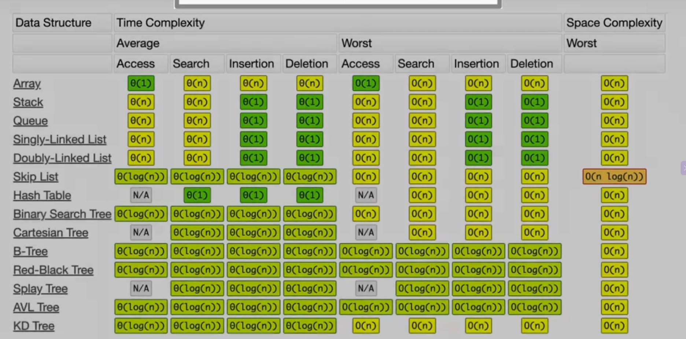

# PythonDSA
## Batch 1 — Arrays + Hash Maps ⭐⭐⭐⭐⭐
This is the highest priority because you already encountered dictionary aggregation today.
1. Two Sum
2. Contains Duplicate
3. First Non-Repeating Character
4. Group Anagrams
5. Top K Frequent Elements
6. Product of Array Except Self
7. Longest Consecutive Sequence
8. Subarray Sum Equals K
9. Majority Element
10. Best Average Grade

## Batch 2 — Two Pointers + Sliding Window ⭐⭐⭐⭐⭐
You have already encountered the first one.
1. Trapping Rain Water — redo from memory
2. Container With Most Water
3. Valid Palindrome
4. Two Sum II
5. 3Sum
6. Move Zeroes
7. Best Time to Buy/Sell Stock
8. Longest Substring Without Repeating Characters
9. Longest Repeating Character Replacement
10. Minimum Size Subarray Sum

## Batch 3 — Binary Search + Sorted Arrays ⭐⭐⭐⭐⭐
Very important for Goldman; rotated-array questions have appeared in recent candidate reports. 
1. Binary Search
2. First/Last Position
3. Search Insert Position
4. Search Rotated Sorted Array
5. Minimum in Rotated Sorted Array
6. Find Peak Element
7. Koko Eating Bananas
8. Search 2D Matrix
9. Square Root
10. Median of Two Sorted Arrays — stretch problem

## Batch 4 — Stack + Queue ⭐⭐⭐⭐
1. Valid Parentheses
2. Min Stack
3. Evaluate Reverse Polish Notation
4. Daily Temperatures
5. Next Greater Element
6. Asteroid Collision
7. Simplify Path
8. Decode String
9. Largest Rectangle in Histogram
10. Sliding Window Maximum

## Batch 5 — Linked Lists ⭐⭐⭐⭐
1. Reverse Linked List
2. Middle of Linked List
3. Linked List Cycle
4. Find Cycle Start
5. Merge Two Sorted Lists
6. Remove Nth Node From End
7. Reorder List
8. Add Two Numbers
9. Copy List With Random Pointer
10. LRU Cache

## Batch 6 — Trees / BST / BFS / DFS ⭐⭐⭐⭐⭐
This is where I expect your largest learning jump.
1. Maximum Depth of Binary Tree
2. Same Tree
3. Invert Binary Tree
4. Level Order Traversal
5. Diameter of Binary Tree
6. Balanced Binary Tree
7. Validate BST
8. Kth Smallest in BST
9. Lowest Common Ancestor
10. Tallest Tree in a Forest

## Batch 8 — Graphs ⭐⭐⭐⭐
1. Number of Islands
2. Flood Fill
3. Clone Graph
4. Rotting Oranges
5. Course Schedule
6. Number of Connected Components
7. Pacific Atlantic Water Flow
8. Word Ladder
9. Detect Cycle
10. Shortest Path in Unweighted Graph

## Batch 9 — Recursion + Backtracking ⭐⭐⭐
1. Fibonacci recursion
2. Generate Parentheses
3. Subsets
4. Subsets II
5. Permutations
6. Combination Sum
7. Letter Combinations
8. Word Search
9. Palindrome Partitioning
10. N-Queens

## Batch 10 — Dynamic Programming ⭐⭐⭐⭐
Don't begin here.

We'll reach DP after the earlier patterns become comfortable.
1. Climbing Stairs
2. House Robber
3. House Robber II
4. Coin Change
5. Minimum Path Sum
6. Unique Paths
7. Longest Increasing Subsequence
8. Longest Common Subsequence
9. Longest Palindromic Subsequence
10. 0/1 Knapsack

